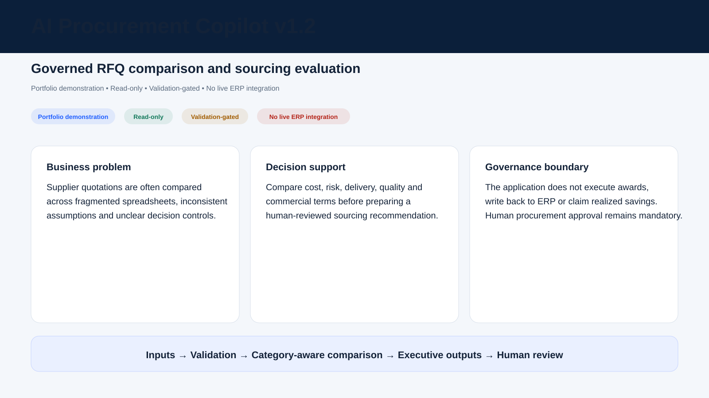

# AI Procurement Copilot

**Governed, category-aware procurement decision support for RFQ comparison, sourcing evaluation and calculation explainability.**

> Portfolio demonstration · Read-only governance layers · Validation-gated · Human approval mandatory · No live ERP write-back



**Hosted application:** `https://ai-procurement-copilot.streamlit.app/`

**Repository:** `pratikoperations/AI-Procurement-Copilot`

## Current repository status

- Current canonical `main` baseline: **`80f6330ccb1a98fe3410359761505831efef9ef8`**.
- Latest governed extension: **Logistics & Freight / LOGISTICS-0 through LOGISTICS-5**, using Domestic Road Transportation — Full Truck Load (FTL) as the representative service.
- Latest post-merge authoritative Quality Checks: **run 1168 / run ID `38610533168` — SUCCESS** on exact main SHA `80f6330ccb1a98fe3410359761505831efef9ef8`.
- Operating mode: **portfolio/interview product under stabilization freeze**. Routine feature and cosmetic expansion remains closed.
- MRO / Industrial Supplies remains a **Foundation Preview only** with governed identity, evidence, commercial and technical-compatibility contracts.
- Logistics & Freight is also a **Foundation Preview**. Its FTL route supports governed freight normalization, buyer-threshold carrier evaluation, human-proposed allocation scenarios, explicit negotiation-position analysis and SourceMate evidence integration without autonomous ranking, allocation, negotiation or award authority.
- SourceMate remains a **project-wide, read-only, deterministic assistant with chat-style UX, browser-session conversation continuity and page-aware governed context**. It does not browse the web, call an external LLM, use RAG, recalculate authoritative procurement results or execute procurement actions.
- Public upload safety remains explicit: use only synthetic or sanitized files; do not upload confidential supplier quotations, contracts, proprietary company information, personal data, credentials or commercially sensitive documents.
- Frozen v1.2 release baseline: **`4803b1d72fa8a6509d9d7faf0e9decc677c447be`**.
- Frozen v1.1 baseline: **`b85cd37aaae709058eb15350d680b18c03da46ba`**.
- No later tag or GitHub Release has been created by deliberate governance decision.
- Hosted acceptance of the post-MRO-0 deployed app remains a **separate manual evidence gate** and is not implied by CI success.

Historical v1.1 and v1.2 records remain unchanged. Later governed work is additive and does not convert this portfolio application into production enterprise software.

## Procurement taxonomy

The application uses three user-facing procurement categories:

- **Packaging Materials**
- **Raw Materials**
- **Indirect Procurement**
  - MRO / Industrial Supplies
  - Logistics & Freight

MRO and Logistics remain separate governed engines underneath Indirect Procurement. The taxonomy is an information-architecture layer; it does not merge their business rules or calculation contracts.

## Business problem

Procurement teams often compare supplier quotations across disconnected spreadsheets, inconsistent assumptions and incomplete evidence. A lowest-price result can be mistaken for a best-value decision, while formula source, assumption provenance, trace identity and evidence quality remain difficult to explain.

AI Procurement Copilot turns that fragmented review into a visible, governed decision-support workflow. It helps procurement professionals compare quotations, test sourcing scenarios, prepare negotiation positions and inspect calculation evidence without replacing human approval.

## Five business questions answered

1. Are supplier quotations sufficiently complete and valid for comparison?
2. How do quotations compare after governed currency, unit and comparison-basis handling?
3. Which commercial, cost, risk and sourcing factors materially affect the recommendation?
4. Which calculations, assumptions, versions and evidence support a result?
5. When should the system withhold or qualify award-oriented language because evidence is incomplete?

## Workflow

1. Select a category, commodity and commercial assumptions.
2. Load synthetic data, a sanitized RFQ CSV/XLSX, or the controlled governed-workbook review route when enabled.
3. Validate structure, completeness, currency, units and business rules.
4. Compare supplier cost, risk, performance, ESG and commercial conditions for active analytical categories.
5. Review scenarios, allocation options and negotiation intelligence where the selected engine is active.
6. Inspect the Governed Calculation Explorer, assumption provenance, trace, reconciliation and SourceMate evidence.
7. Generate executive-facing and machine-readable outputs.
8. Complete human procurement review and approval outside the application.

For **MRO / Industrial Supplies**, MRO-0 intentionally stops at the governed Foundation Preview before analytical execution.

See [User Workflow](docs/03_USER_WORKFLOW.md).

## Key capabilities

- Packaging and raw-material procurement workflows
- Supplier quotation validation and governed comparison
- Original and normalized quotation-data preservation
- USD, INR and dual-display handling
- Category-specific should-cost, TCO, risk and scoring for active analytical categories
- Procurement Intelligence and Supplier Intelligence views
- Supplier 360, performance, financial, ESG, innovation and SRM analysis
- Scenario testing, allocation and negotiation support for active analytical categories
- Validation-gated recommendation language
- Executive memos, supplier communication and governed downloads
- Read-only ERP workbook structural preview with draft mappings
- Controlled governed-workbook review and default-off analytical handoff
- Governed calculation catalogue and assumption provenance
- Deterministic calculation traces with retained configuration versions
- Reconciliation and export evidence assurance
- Governed Calculation Explorer with readable evidence and calculation payloads
- Project-wide SourceMate with chat-style UX, browser-session conversation continuity and page-aware governed context
- MRO / Industrial Supplies Foundation Preview with explicit manufacturer + part-number identity, source-status governance, fail-closed technical compatibility and human substitution approval
- Logistics & Freight Foundation Preview for Domestic Road Transportation — FTL with governed freight normalization, carrier policy evaluation, human-proposed allocation scenarios, negotiation-position analysis and SourceMate evidence
- Explicit adapter-backed and `unsupported_deferred_coverage` states
- Evidence-derived, read-only human-review checklist
- Responsive/mobile acceptance coverage for governed test profiles
- Explicit public-demo upload/privacy warnings

## MRO-0 governance boundary

MRO-0 adds **Industrial Bearings** as the first representative MRO commodity and intentionally remains a foundation-only capability:

- manufacturer and manufacturer-part-number identity are explicit;
- source status is explicit: OEM, Authorized Distributor or Approved Equivalent;
- required technical evidence is evaluated fail-closed;
- Approved Equivalent substitution requires explicit human approval;
- supplier selection remains a human procurement decision;
- risk dimensions are qualitative and no unsupported numerical weights are introduced;
- synthetic demonstration evidence must not be represented as manufacturer certification or live supplier verification;
- no MRO should-cost, supplier scoring, scenario, negotiation or allocation engine is active.

## EAS-BIV coverage

Dedicated adapter-backed coverage remains exactly:

- `REC-PET`
- `REC-KRF`
- `REC-COR`
- `REC-LAM`
- `REC-STL`
- `REC-SCORE-GEN`
- `REC-ELG`

All remaining non-export routes remain `unsupported_deferred_coverage`. Deferred routes are not represented as adapter-reconciled and do not receive fabricated traces.

## What this project proves

- Practical understanding of procurement and sourcing workflows
- Ability to translate procurement requirements into a working application
- Category-aware comparison and decision-support logic
- Controlled validation and human-review gates
- Calculation metadata, assumption provenance and deterministic trace design
- Reconciliation and evidence-boundary governance
- Automated testing, branch discipline and exact-head change governance
- Clear separation between business-facing reports and audit outputs
- Governed ERP-export intake without overstating integration maturity
- A project-wide read-only assistant grounded in existing governed application evidence
- Extensible category architecture with bounded MRO and Logistics foundations that do not overstate analytical or production maturity
- Scope discipline through explicit deferred coverage and stabilization freeze
- Public-demo privacy and data-handling boundary awareness

## What it does not prove

- Production deployment readiness
- Live SAP or Oracle integration
- Universal ERP or category compatibility
- Enterprise-scale performance or security
- External evidence verification
- Realized savings from live organizational use
- Autonomous sourcing, supplier approval or award execution
- Approval persistence, production allocation or ERP write-back
- Formal browser/mobile or WCAG certification
- Production-ready MRO analytics or automated equivalent-part approval
- Production TMS capability, live freight-market feeds, route optimization, autonomous carrier allocation/negotiation or carrier-award authority

## Current test and quality evidence

Current main baseline:

- exact `main` SHA: `80f6330ccb1a98fe3410359761505831efef9ef8`;
- LOGISTICS-5 PR #119 source head: `eb5f32dda920b9eeb01b08f930fb9f80dbec8be0`;
- PR Quality Checks run 1167 — SUCCESS;
- PR Mobile Browser Acceptance run 173 — SUCCESS;
- post-merge main Quality Checks run 1168 / run ID `38610533168` — SUCCESS.

Earlier exact-head regression evidence remains historical and valid only for its stated baseline. Automated browser acceptance is evidence for governed test profiles, not certification across every physical device/browser. Hosted behavior remains a separate manual acceptance gate when required.

Historical gate-specific evidence remains available in [Test Evidence](docs/06_TEST_EVIDENCE.md), [EAS-BIV Interview Evidence Pack](docs/EAS_BIV_INTERVIEW_EVIDENCE_PACK.md) and [Release Record](docs/09_RELEASE_RECORD.md).

## Governance and limitations

- Human procurement approval remains mandatory.
- Formula metadata is documentation only and is never executed.
- Existing business services produce authoritative results.
- Unavailable evidence is disclosed and is not reconstructed.
- SourceMate is read-only, uses current governed application/project evidence and does not perform external verification.
- SourceMate has no web browsing, external LLM, RAG, hidden recalculation, autonomous recommendation, supplier approval, award, production allocation or ERP write-back authority.
- MRO Foundation Preview has no should-cost, scoring, scenario, negotiation or allocation execution authority.
- Logistics Foundation Preview does not use live market/route/telematics feeds, does not rank carriers with hidden weights, does not optimize carrier shares, does not negotiate autonomously and does not execute awards or TMS/ERP writeback.
- Deferred routes are not represented as adapter-reconciled.
- The application does not execute transactions or mutate ERP systems.
- Illustrative monetary outputs are not realized-savings claims.
- Synthetic or sanitized data should be used for public demonstration.
- Public users should not upload confidential supplier quotations, contracts, proprietary company information, personal data, credentials or commercially sensitive documents.
- Production use would require enterprise identity, security, privacy, logging, monitoring and operational controls.

See [Governance and Limitations](docs/07_GOVERNANCE_AND_LIMITATIONS.md).

## Documentation by audience

- [Executive Overview](docs/01_EXECUTIVE_OVERVIEW.md)
- [Business Case Study](docs/02_BUSINESS_CASE_STUDY.md)
- [User Workflow](docs/03_USER_WORKFLOW.md)
- [Architecture](docs/04_ARCHITECTURE.md)
- [Data and Validation](docs/05_DATA_AND_VALIDATION.md)
- [Test Evidence](docs/06_TEST_EVIDENCE.md)
- [Governance and Limitations](docs/07_GOVERNANCE_AND_LIMITATIONS.md)
- [Demo Guide](docs/08_DEMO_GUIDE.md)
- [Release Record](docs/09_RELEASE_RECORD.md)
- [S1 Build Closure](docs/S1_BUILD_CLOSURE.md)
- [EAS-BIV Final Closure](docs/EAS_BIV_FINAL_CLOSURE.md)
- [EAS-BIV Interview Evidence Pack](docs/EAS_BIV_INTERVIEW_EVIDENCE_PACK.md)
- [Logistics Final Closure](docs/LOGISTICS_FINAL_CLOSURE.md)

## Technical setup

```bash
pip install -r requirements.txt
streamlit run app.py
```

Run tests:

```bash
python -m pytest
```

Detailed setup and portability guidance remain in `SETUP_GUIDE.md`, `AI_HANDOFF_GUIDE.md` and `PROJECT_ARCHITECTURE.md`.

## Version and build history

| Version/build | Position |
|---|---|
| v1.0.0 | First stable Portfolio Edition baseline |
| v1.0.1 | Governed maintenance release |
| v1.1 | Completed ERP structural foundation and read-only ERP Upload Preview; frozen at `b85cd37aaae709058eb15350d680b18c03da46ba` |
| v1.2 | Completed Portfolio Presentation Release; frozen at `4803b1d72fa8a6509d9d7faf0e9decc677c447be` |
| v1.3 foundation | Versioned workbook contracts, adapter, orchestration, governed review and default-off analytical handoff |
| S1.1–S1.5.1 | UX, accessibility, responsiveness and runtime-hardening programme |
| EAS-BIV Gates 1A–5 | Calculation provenance, traces, reconciliation, governed explorer, SourceMate evidence view and closure |
| Stabilized portfolio build — Aug 2026 | Cross-category consistency, Steel shared-workflow reconciliation, project-wide SourceMate, chat-style UX, decision-result hierarchy, mobile assurance and public-demo hardening |
| MRO-0 — Oct 2026 | Industrial Supplies Foundation Preview with Industrial Bearings, evidence/source-status contracts, fail-closed compatibility and human approval boundaries |
| LOGISTICS-0–5 — Oct 2026 | Logistics & Freight Foundation Preview for Domestic Road Transportation — FTL covering freight normalization, carrier policy evaluation, human-proposed allocation scenarios, negotiation intelligence, SourceMate evidence integration and interview closure |

## Historical relationship

- Historical EAS-BIV Gate 5 starting baseline: `834b34db145cc0156196579f7419e7db7b438106`; Quality Checks run `816`; `1011` regression tests passed at that historical gate. These remain preserved historical evidence anchors and are not the current product baseline.
- Historical release and gate evidence remains preserved and must not be rewritten as if later work formed part of those earlier baselines.
- Later governed work is additive, stabilization-frozen and bounded; it does not convert the portfolio application into a production, autonomous or live-ERP system.
